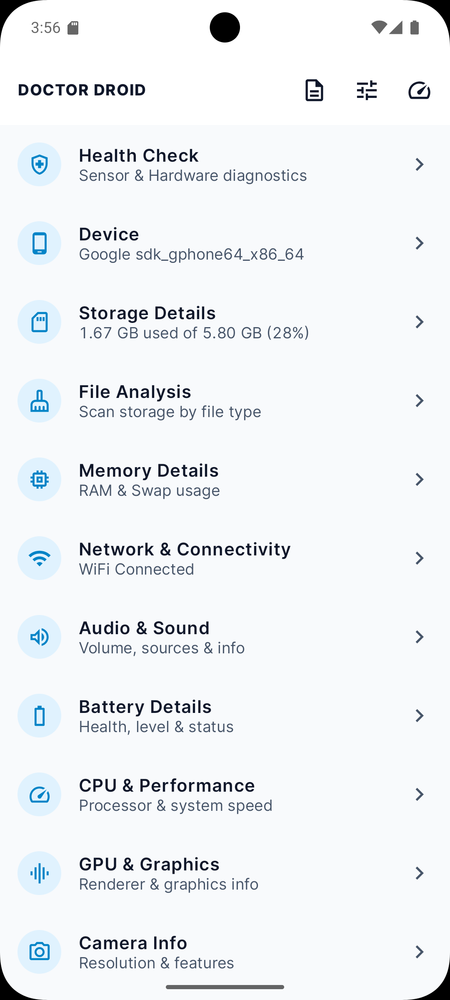
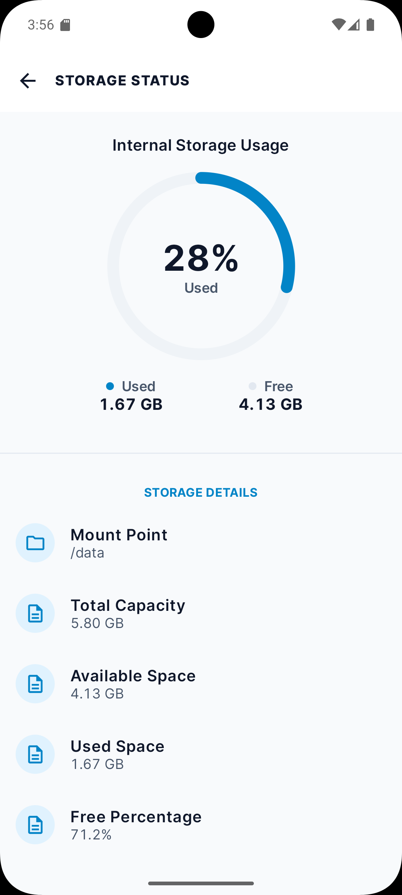
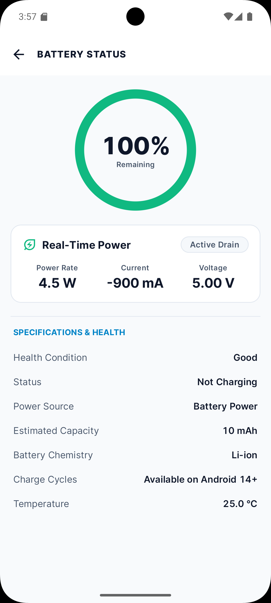
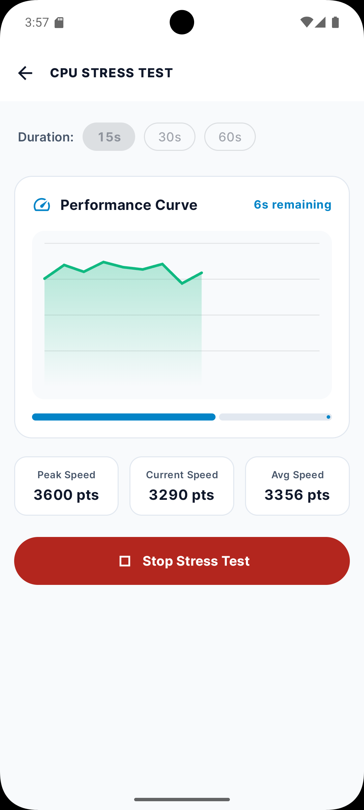
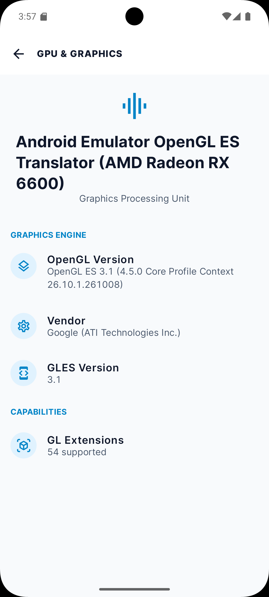
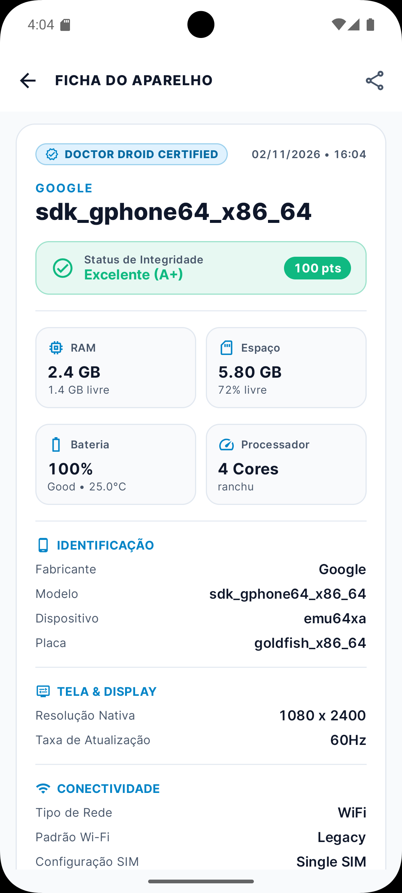

# Doctor Droid 🩺🤖

<p align="center">
  
</p>

<p align="center">
  <strong>Comprehensive Android Diagnostics, Hardware Health Checks & Real-Time System Monitoring</strong>
</p>

<p align="center">
  
  
  
  
  
  
</p>

---

**Doctor Droid** is a modern, high-performance Android hardware diagnostics, system benchmarking, and real-time monitoring application built entirely with **Jetpack Compose** and **Material 3**. 

Architected with MVVM, Kotlin Coroutines, and `StateFlow`, Doctor Droid delivers in-depth visibility into your device internals, an interactive hardware test suite, storage analysis, and an always-on floating monitor overlay.

---

## 📱 Screenshots

<div align="center">
  
  
  
</div>

<div align="center" style="margin-top: 12px;">
  
  
  
</div>

---

## ⚡ Key Features

### 🔍 Comprehensive Device Specifications & Summary
- **Hardware & SoC**: Processor name, cluster architecture, governor, live per-core frequencies, and instruction sets (ABI).
- **Display & Graphics**: Screen resolution, refresh rate (Hz), pixel density (DPI), HDR support, OpenGL ES, and Vulkan version.
- **Operating System**: Android version, API level, security patch date, build fingerprint, kernel version, Project Treble, and Seamless System Updates (A/B) status.
- **DRM & Media**: DRM security levels (Widevine L1/L3), supported media codecs, and audio capabilities.

### 🧪 Interactive Hardware Diagnostic Suite
- **Interactive Sensor Sandbox**: Real-time 3D tilt-ball physics test for Accelerometer & Gyroscope, plus dynamic visual telemetry for Proximity, Light (Lux), Magnetometer (Compass), and Barometer.
- **Touch Screen Grid Test**: Interactive full-screen touch matrix to detect dead zones, ghost touches, and multi-touch capabilities.
- **Dead Pixel Screen Test**: Immersive full-screen pure RGB (Red, Green, Blue, White, Black) tester with auto/tap advance to identify stuck or dead sub-pixels.
- **CPU Stress Test**: Multi-threaded load stress test with real-time temperature throttling and frequency tracking under heavy compute workloads.
- **Hardware Component Diagnostics**: Flashlight strobe & intensity tests, stereo speaker left/right frequency tone sweeps, microphone loopback checks, and vibration motor haptic pulse patterns.

### 🔋 Battery & Thermal Health
- **Live Battery Telemetry**: Current percentage, health condition, voltage, temperature, technology, and estimated capacity.
- **Charging Monitor**: Real-time detection of charging source (AC, USB, Wireless) with charging state indicators and animations.
- **Thermal Sensors**: Real-time thermal zone readings (CPU, GPU, Battery, Ambient) to detect device thermal throttling.

### 🧹 Storage & File Analysis Cleaner
- **Categorized Storage Breakdown**: Visual storage consumption charts across Apps, Images, Audio, Videos, Documents, and System.
- **Deep Cleaner**: Quickly inspect large files (>100MB), redundant APK installers, empty directories, and temporary cache files.

### 📶 Network & Connectivity
- **Wi-Fi & Cellular Details**: Active connection status, SSID, BSSID, RSSI signal strength, link speed, frequency bands (2.4GHz / 5GHz / 6GHz), IPv4/IPv6 addresses, MAC address, and gateway details.
- **SIM & Carrier**: Dual SIM status, carrier names, network generation (5G/4G/3G), roaming state, and mobile data status.

### 🛠️ Quick Controls & Utilities
- **Centralized System Sliders**: In-app controls for screen brightness, media volume, ring volume, notifications, and alarm volume.
- **System Shortcuts**: One-tap access to Wi-Fi settings, Bluetooth pairings, Developer Options, Location toggles, Battery Saver, and App Manager.

### 🪟 Real-time Floating Monitor Overlay
- Lightweight, draggable Picture-in-Picture system overlay that displays real-time CPU load, RAM usage, and battery temperature while playing games or testing other apps.

---

## 🏗️ Architecture & Tech Stack

Doctor Droid is engineered following the official **Modern Android Architecture (MVVM)** guidelines:

- **Language**: Kotlin 2.x
- **UI Framework**: [Jetpack Compose](https://developer.android.com/jetpack/compose) (100% declarative UI)
- **Design System**: Material Design 3 with custom Tailwind-inspired dark theme
- **State Management**: Android Architecture Components `ViewModel` + Kotlin Coroutines & `StateFlow`
- **Navigation**: Jetpack Navigation Compose
- **Typography & Theming**: Dynamic Google Fonts (JetBrains Mono for monospace data values, Inter/Roboto for UI text)
- **Services**: Android Foreground Services (`FloatingMonitorService`) with window overlay manager

---

## 🚀 Getting Started

### Prerequisites
- Android Studio Ladybug / Meerkat (or newer)
- Android SDK 35 (`compileSdk 35`, `minSdk 26`)
- Java 17 / 21 (JDK)

### Build and Run
1. Clone the repository:
   ```bash
   git clone https://github.com/carllosnc/doctordroid.git
   cd doctordroid
   ```
2. Open the project in **Android Studio**.
3. Let Gradle sync project dependencies.
4. Connect an Android device (or launch an emulator) with Developer Mode & USB Debugging enabled.
5. Click **Run** (`Shift + F10`) or execute:
   ```bash
   ./gradlew installDebug
   ```

---

## 📄 License & Credits

Developed with ❤️ by **CarlosNC** ([@carllosnc](https://github.com/carllosnc)).  
All rights reserved.
